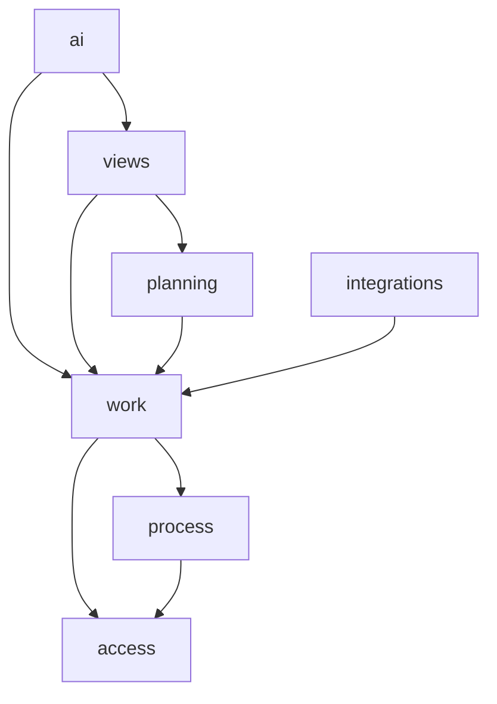
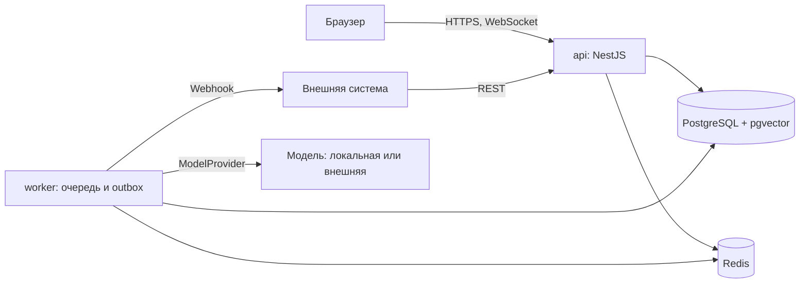
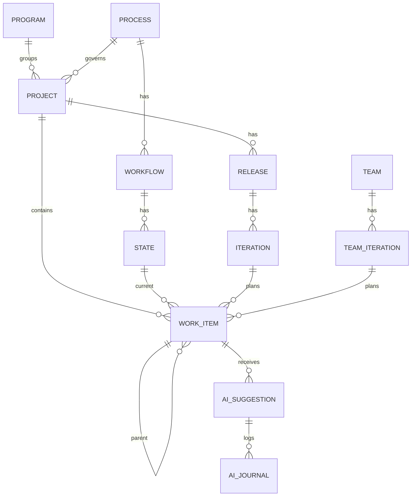

# Architecture Spine — Вектор

> Учебный пример: вымышленный продукт. Режим Fast path: решения предложены ИИ, код не написан. Версии проверены по npm 2026-11-01 и по образам, которые реально запущены для Docmost.

## Design Paradigm

Модульный монолит. Каждый модуль лежит в `apps/api/src/modules/<модуль>` и делится на `domain`, `application`, `adapters`. Другие модули обращаются только к его `application`.

## Invariants & Rules



Стрелка значит «может зависеть». Обратные зависимости запрещены.

### AD-1 — Границы модулей

- **Binds:** all
- **Prevents:** прямые обращения к таблицам чужого модуля
- **Rule:** модуль импортирует только `application` другого модуля по графу выше. Правило проверяет линтер в CI.

### AD-2 — Единая таблица Work Item

- **Binds:** FR-3, FR-4, FR-5
- **Prevents:** разные модели и логика связей для каждого типа
- **Rule:** все типы хранятся в `work_item` с полем `type` и `parent_id`. Правила иерархии проверяет один `HierarchyPolicy` в домене `work`.

### AD-3 — Единый источник правил Workflow

- **Binds:** FR-6, FR-11, FR-21
- **Prevents:** расхождение правил между Board, API и импортом
- **Rule:** смена State выполняется только командой `TransitionWorkItem`, она проверяет Workflow и Role. Прямая запись в поле `state_id` запрещена.

### AD-4 — AI Suggestion отделено от Work Item

- **Binds:** FR-17, FR-18, FR-19, FR-20
- **Prevents:** изменение данных без подтверждения человека
- **Rule:** модуль `ai` пишет только в `ai_suggestion` и `ai_journal`. Применение это отдельный запрос пользователя, он вызывает обычные команды модуля `work` от имени этого пользователя.

### AD-5 — AI Gateway

- **Binds:** FR-16, NFR-3
- **Prevents:** прямые вызовы модели и утечку данных за контур
- **Rule:** к модели обращается только порт `ModelProvider` в `ai`. Адрес берётся из Model Connection. Сетевые библиотеки вне этого адаптера запросы к моделям не выполняют.

### AD-6 — Неизменяемый AI Journal

- **Binds:** FR-17, NFR-7
- **Prevents:** подмену истории решений
- **Rule:** роль приложения в БД имеет на `ai_journal` только `INSERT` и `SELECT`.

### AD-7 — Права на границе приложения

- **Binds:** FR-2, FR-15, FR-19, FR-21
- **Prevents:** утечку через поиск, виджеты и ИИ
- **Rule:** каждый запрос чтения получает `ProjectScope` из модуля `access`. Запрос без `ProjectScope` не компилируется. Чужой Project даёт 404, нехватка Role даёт 403.

### AD-8 — События через outbox

- **Binds:** FR-11, FR-22
- **Prevents:** потерю событий и двойные реализации реального времени
- **Rule:** изменение и событие пишутся в одной транзакции в `outbox`. Обработчик рассылает события в WebSocket и Webhook.

### AD-9 — Единый FilterSpec

- **Binds:** FR-12, FR-14, FR-15, FR-20
- **Prevents:** разные языки фильтров и выполнение текста от модели
- **Rule:** фильтр везде один JSON `FilterSpec`, проверяемый схемой. AI-фильтр возвращает только `FilterSpec`. SQL от модели не принимается.

### AD-10 — ИИ работает асинхронно

- **Binds:** NFR-2, NFR-6
- **Prevents:** блокировку интерфейса и зависимость трекера от модели
- **Rule:** запросы к модели идут через очередь. Ни один запрос без ИИ не зависит от доступности модели.

### AD-11 — Поиск похожего внутри PostgreSQL

- **Binds:** FR-19
- **Prevents:** отдельное хранилище и обход прав
- **Rule:** векторы хранятся в `pgvector` с `project_id`, поиск всегда ограничен `ProjectScope`.

## Consistency Conventions

| Concern | Convention |
| --- | --- |
| Именование | Таблицы `snake_case` в единственном числе, термины только из Глоссария |
| Идентификаторы | UUIDv7 |
| Даты | UTC, ISO 8601 |
| Ошибки API | RFC 9457 Problem Details, поле `code` стабильно |
| Списки API | Курсорная пагинация |
| Логи | JSON, текст Work Item и промпты в логи не пишутся |
| Настройки | Через переменные окружения, ключи шифруются в БД |

## Stack

| Name | Version |
| --- | --- |
| TypeScript | 7.0.2 |
| Node.js | 24.18.0 |
| NestJS | 12.3.2 |
| React | 19.3.1 |
| Vite | 8.3.5 |
| Drizzle ORM | 0.45.4 |
| BullMQ | 6.5.3 |
| PostgreSQL | 18 |
| pgvector (клиент) | 0.3.0 |
| Redis | 8 |
| dnd-kit | 6.3.1 |
| Vitest | 5.0.5 |
| Playwright | 1.64.1 |

## Structural Seed

### Контейнеры



### Основные сущности



### Развёртывание

Один `docker-compose.yml`: `api`, `worker`, `web`, `postgres`, `redis`. Локальная модель работает как отдельная служба заказчика, Вектор знает только её адрес. Окружения: `dev`, `staging`, `production`.

### Исходный код

```text
vektor/
  apps/api/src/modules/   # access, process, work, planning, views, ai, integrations
  apps/worker/            # очереди и outbox
  apps/web/               # React-приложение
  packages/contracts/     # FilterSpec и типы API
  deploy/                 # docker-compose и настройки окружений
```

## Capability → Architecture Map

| Capability / Area | Lives in | Governed by |
| --- | --- | --- |
| FR-1, FR-2 | `access` | AD-7 |
| FR-3, FR-4, FR-5 | `work` | AD-2, AD-3 |
| FR-6, FR-7 | `process` | AD-3 |
| FR-8, FR-9, FR-10 | `planning` | AD-1 |
| FR-11 — FR-15 | `views` | AD-8, AD-9 |
| FR-16 — FR-20 | `ai` | AD-4, AD-5, AD-6, AD-9, AD-10, AD-11 |
| FR-21, FR-22 | `integrations` | AD-3, AD-8 |

## Deferred

- Team Workflow: не входит в v1, таблицы можно добавить без изменения AD-3.
- Выбор конкретной модели: зависит от пилота, скрыт портом `ModelProvider`.
- Горизонтальное масштабирование `api`: для целевого размера хватает одного экземпляра.
- Резервное копирование и мониторинг: определяются при установке у пилотного заказчика.
