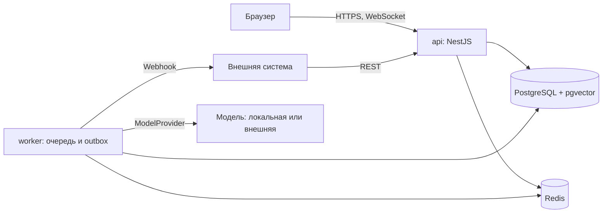
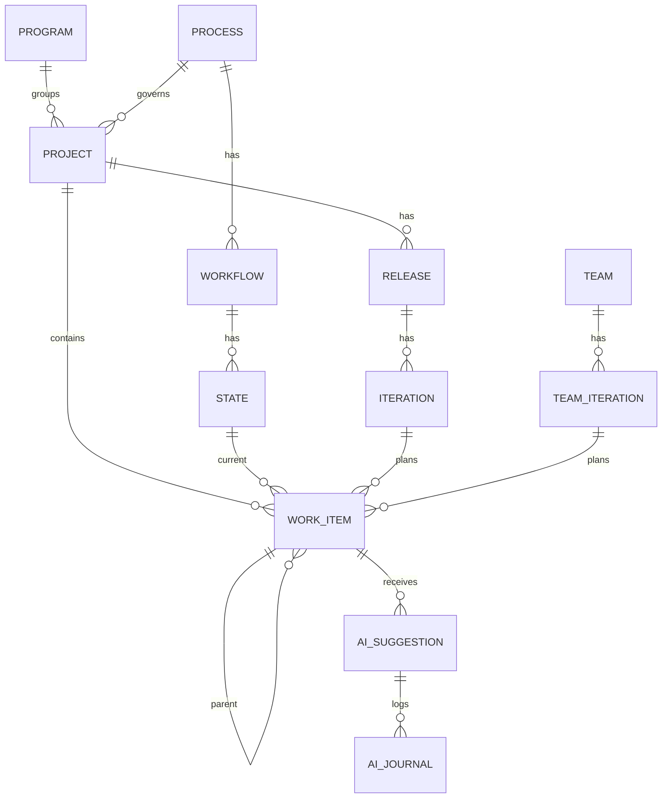

## Structural Seed

### Контейнеры



### Основные сущности



### Развёртывание

Один `docker-compose.yml`: `api`, `worker`, `web`, `postgres`, `redis`. Локальная модель работает как отдельная служба заказчика, Вектор знает только её адрес. Окружения: `dev`, `staging`, `production`.

### Исходный код

```text
vektor/
  apps/api/src/modules/   # access, process, work, planning, views, ai, integrations
  apps/worker/            # очереди и outbox
  apps/web/               # React-приложение
  packages/contracts/     # FilterSpec и типы API
  deploy/                 # docker-compose и настройки окружений
```
