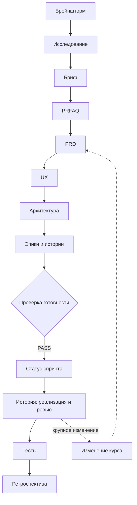
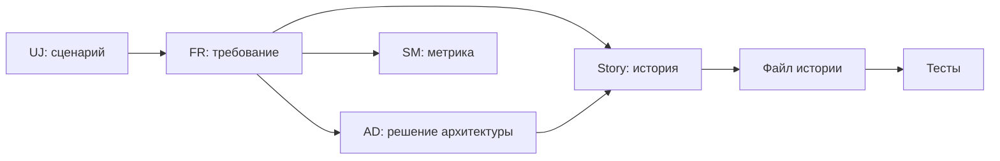

# Как читать этот пример

Это полный пример документации по методу BMAD (BMad Method 6.12.4) на вымышленном продукте **Вектор**: AI-трекере работы, устроенном по образцу модели Targetprocess. Вектор не связан с Targetprocess или IBM.

Документы идут в порядке, в котором их создаёт команда. Каждый следующий шаг берёт на вход результат предыдущего.

> Что здесь настоящее, а что смоделировано: шаблоны, структура папок и проверки настоящие. `lint_spine`, `sprint_plan`, `sprint_status` и `memlog` действительно запускались. Продукт, люди, заказчик и числовые цели вымышлены. Кода Вектора нет, поэтому реализация, ревью, тесты и ретроспектива показывают только форму документов. Документы созданы ИИ в ускоренном режиме, без обычного диалога BMAD с человеком.

## Путь проекта

## Шаги и документы

| Фаза | Шаг | Навык BMAD | Обязателен | Документ |
| --- | --- | --- | --- | --- |
| Анализ | Идеи | `bmad-brainstorming` | Нет | Итог брейншторма |
| Анализ | Исследование | `bmad-deep-recon` | Нет | Исследование модели Targetprocess |
| Анализ | Бриф | `bmad-product-brief` | Нет | Product Brief |
| Анализ | Проверка идеи | `bmad-prfaq` | Нет | PRFAQ |
| Планирование | Требования | `bmad-prd` | **Да** | PRD и Дополнение |
| Планирование | Дизайн | `bmad-ux` | Нет | DESIGN, EXPERIENCE, макеты |
| Решения | Архитектура | `bmad-architecture` | **Да** | Architecture Spine |
| Решения | Разбивка | `bmad-create-epics-and-stories` | **Да** | Эпики и истории |
| Решения | Готовность и спринт | `bmad-sprint-planning` | **Да** | Проверка готовности, Статус спринта |
| Реализация | Сборка истории | `bmad-build` | **Да** | Истории 1.1, 1.2, 1.3 |
| Реализация | Тесты | `bmad-qa-generate-e2e-tests` | Нет | Сводка автотестов |
| Реализация | Изменение курса | `bmad-correct-course` | Нет | Sprint Change Proposal |
| Реализация | Ретроспектива | `bmad-retrospective` | Нет | Ретроспектива Эпика 1 |
| В любой момент | Контекст для агентов | `bmad-project-context` | Нет | Контекст проекта |

## Остальные навыки BMAD

Эти навыки не дают отдельного документа в примере:

| Навык | Что делает | Почему нет документа |
| --- | --- | --- |
| `bmad-help` | Подсказывает следующий шаг | Отвечает в диалоге |
| `bmad-party-mode` | Обсуждение несколькими агентами | Нужен живой диалог |
| `bmad-advanced-elicitation` | Углубляет черновик | Улучшает другие документы |
| `bmad-review` | Рецензирует документ или код | Результат вошёл в истории |
| `bmad-code-review` | Ревью изменения кода | Кода нет, форма видна в Review Triage Log |
| `bmad-walkthrough` | Проводит по изменению | Кода нет |
| `bmad-build-auto` | Сборка без участия человека | Вариант `bmad-build` |
| `bmad-customize` | Настраивает агентов и шаги | Пример использует настройки по умолчанию |
| `bmad-forge-idea` | Проверяет идею вопросами | Эту роль выполнил PRFAQ |
| `bmad-spec` | Сжимает вход в короткий SPEC.md | Другой путь вместо полного PRD |
| `bmad-agent-analyst` | Роль аналитика | Роль, ведёт шаги анализа |
| `bmad-agent-pm` | Роль менеджера продукта | Роль, ведёт PRD |
| `bmad-agent-ux-designer` | Роль UX-дизайнера | Роль, ведёт UX |
| `bmad-agent-architect` | Роль архитектора | Роль, ведёт архитектуру |
| `bmad-agent-dev` | Роль разработчика | Роль, ведёт реализацию |

## Как трассируются требования

Итог проверки скриптом: 23 FR, 20 историй, 4 UJ, 12 AD, ошибок трассировки нет. Линтер архитектуры замечаний не нашёл.

## Где лежат файлы

| Что | Путь на диске |
| --- | --- |
| Установленный BMAD | `bmad-example\_bmad`, в git не входит |
| Навыки для Claude Code | `bmad-example\.claude\skills`, в git не входит |
| Все документы | `bmad-example\_bmad-output` |
| Архитектура и модель системы | `bmad-example\docs\architecture` |
| Макеты экранов | `_bmad-output\planning-artifacts\ux-designs\ux-bmad-example-2026-11-01\mockups` |
